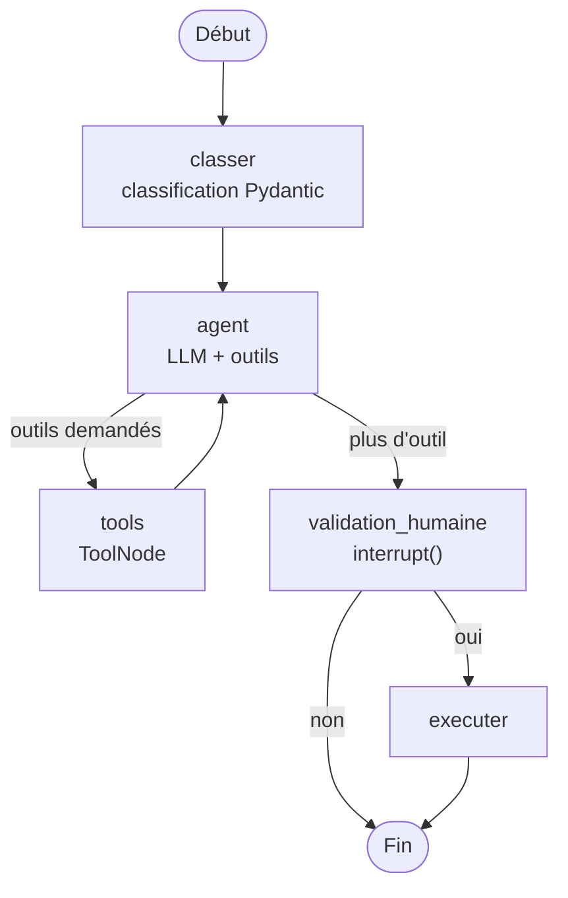
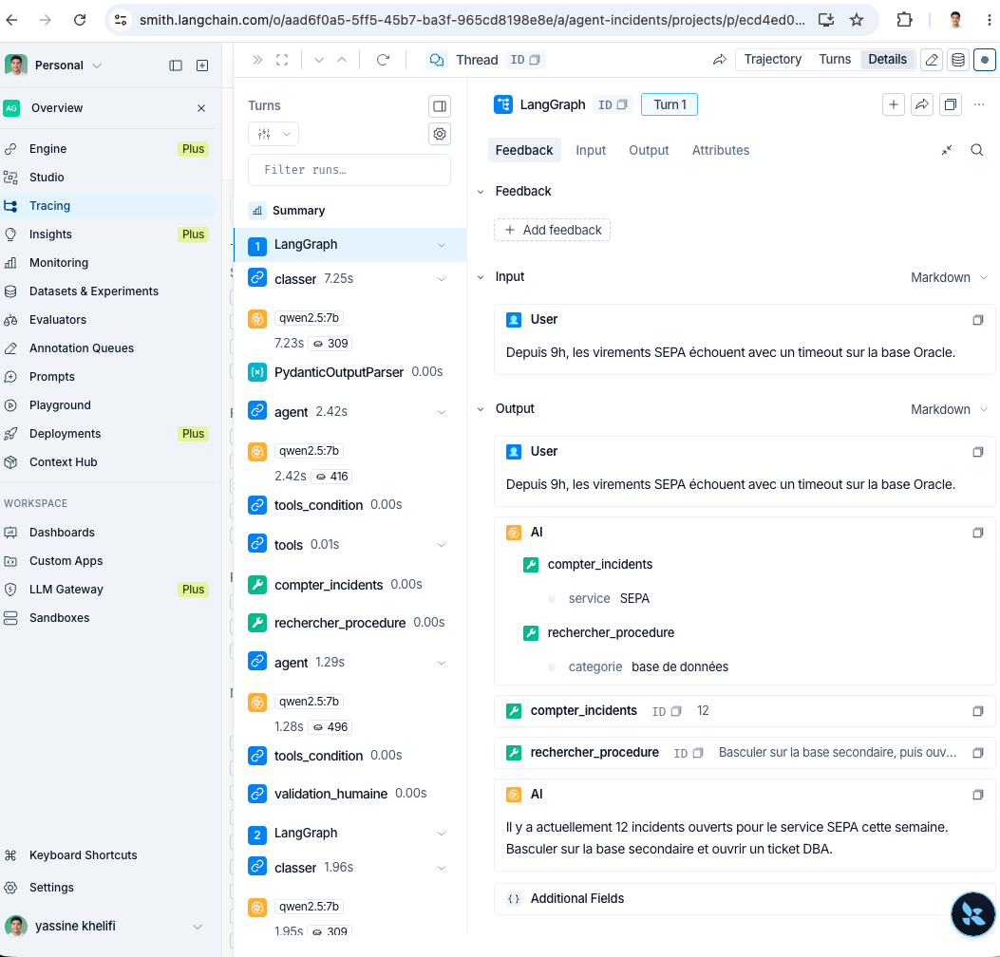
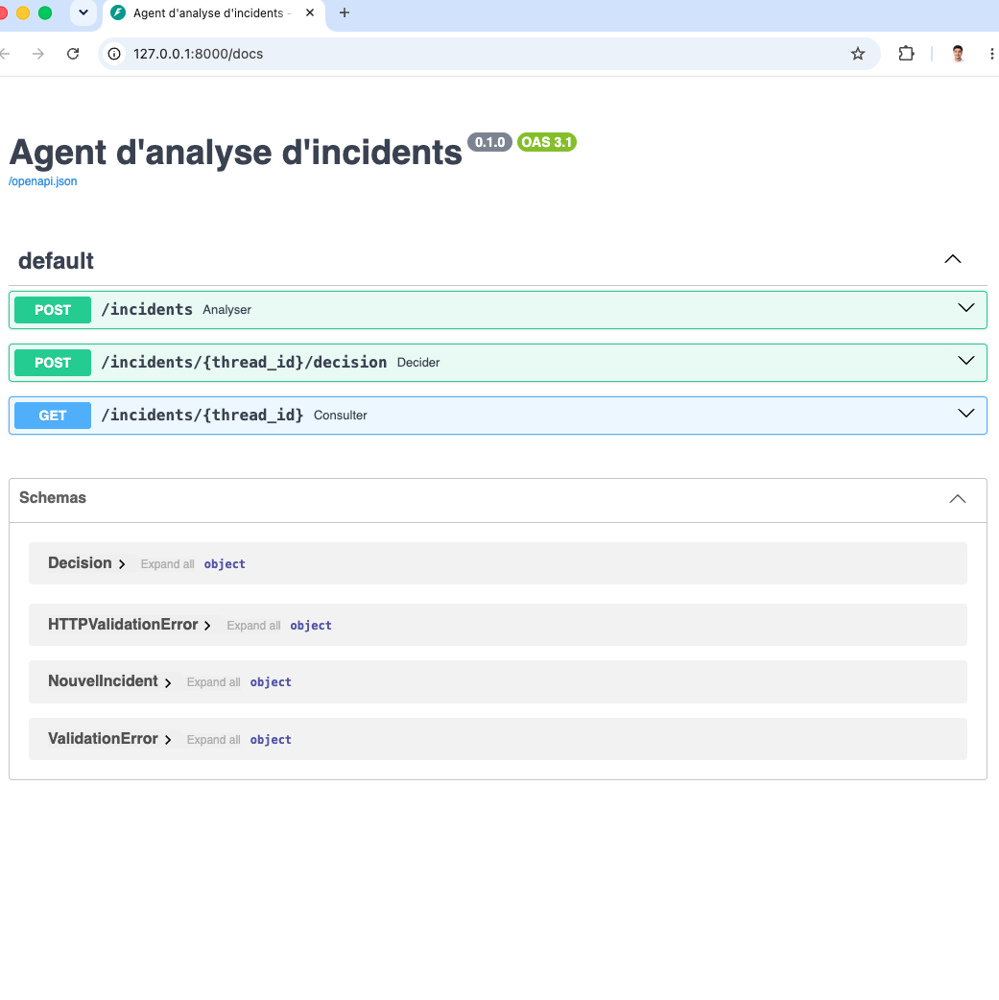
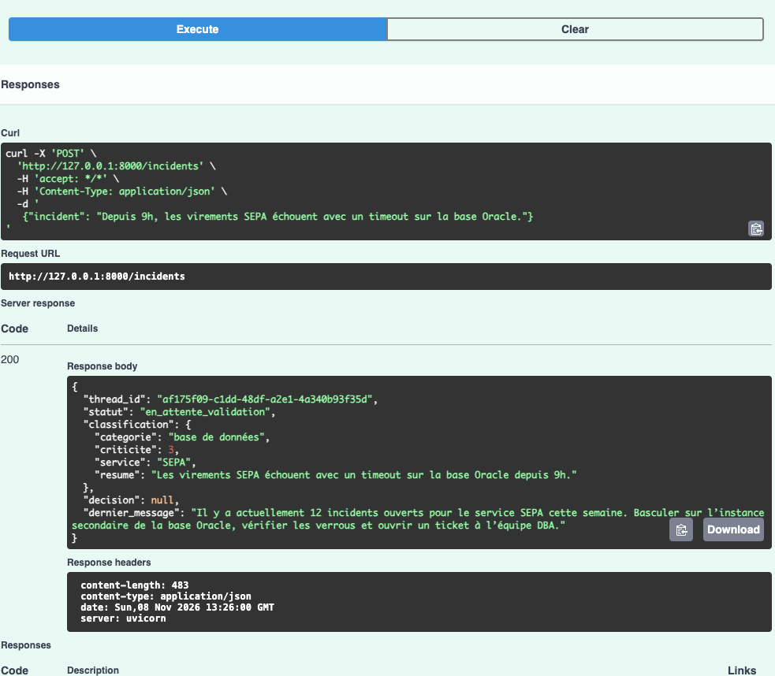

# Agent d'analyse d'incidents bancaires (LangGraph)

Agent IA qui analyse un incident informatique, consulte l'historique et les procédures internes,
propose une action corrective, et **attend la validation d'un opérateur** avant toute exécution.
Projet personnel réalisé pour monter en compétence sur LangGraph. Toutes les données sont fictives.

## Architecture



| Étape | Rôle | Technologie |
|---|---|---|
| classer | Catégorie, criticité, service : sortie validée | LangChain `with_structured_output` + Pydantic |
| agent / tools | Boucle ReAct : l'agent choisit ses outils | LangGraph `StateGraph`, `ToolNode`, `tools_condition` |
| compter_incidents | Historique des incidents par service | Outil `@tool` |
| rechercher_procedure | Recherche sémantique dans les procédures internes (RAG) | LlamaIndex + embeddings `nomic-embed-text` |
| validation_humaine | Pause avant toute action, reprise avec la décision | `interrupt()` + `Command(resume=...)` |
| Mémoire | État sauvegardé par incident (`thread_id`) | Checkpointer `InMemorySaver` |
| Observabilité | Traces et évaluation | LangSmith |

## Choix techniques
- **LLM local (Qwen 2.5 via Ollama)** : aucune donnée ne sort de la machine, contrainte clé en milieu bancaire.
- **Sorties structurées Pydantic** : aucune décision sur du texte libre.
- **Human-in-the-loop** : aucune action sensible sans accord explicite ; toute réponse autre que « oui » est un refus.
- **`temperature=0`** : réponses reproductibles et auditables.

## Résultats
- Classification : **1/5 → 5/5** après ajout de définitions, d'une échelle de criticité et d'une catégorie « hors périmètre ».
- Évaluation LangSmith sur 8 incidents inédits : **8/8**, avec ou sans exemples dans le prompt (ablation).
- Trace d'une exécution : environ 4,6 s et 1 200 tokens, le temps étant concentré dans les appels au LLM.


### API (FastAPI)



## Limites et prochaines étapes
- Jeu d'évaluation petit : l'enrichir avec des cas ambigus et évaluer aussi la criticité.
- L'agent n'applique pas toujours toutes les procédures retrouvées (escalade) : évaluer la génération, pas seulement la recherche.
- Production : checkpointer `PostgresSaver`, API FastAPI, Docker / Kubernetes, validation des entrées.

## Lancer le projet
```bash
ollama pull qwen2.5:7b && ollama pull nomic-embed-text
python -m venv .venv && source .venv/bin/activate
pip install -r requirements.txt
cp .env.example .env            # ajouter sa clé LangSmith
python -m app.graph             # lance l'agent
python -m evals.eval_classification   # lance l'évaluation
```